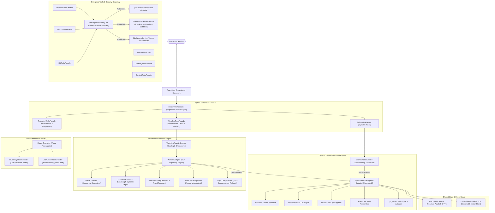

# Computer Agent: Enterprise Multi-Agent Swarm & Workflow Engine

An enterprise-grade, local Multi-Agent AI system engineered in **Java 21** using **LangChain4j**, **Ollama**, **Microsoft Playwright**, **ChromaDB**, **Java 21 Virtual Threads (Project Loom)**, and **OpenTelemetry (OTel)** distributed tracing.

The system features hybrid intent-based orchestration uniting four complementary execution modes:
1. **Dynamic Swarm Orchestration (`DelegationFacade`):** A central supervisor dynamically delegating ad-hoc, exploratory, and parallel tasks to specialized sub-agents with fair Human-in-the-Loop (HITL) locks, isolated `@MemoryId` chat memories, and real-time core memory injection.
2. **Deterministic Declarative DAG Workflows (`WorkflowToolsFacade`):** A LangGraph / Pregel-inspired Bulk Synchronous Parallel (BSP) graph execution engine traversing declarative JSON workflows across virtual thread supersteps, enforcing scoped state contracts (`readChannels`/`writeChannels`), executing atomic checkpointing (`.checkpoints`), and orchestrating automated LIFO Saga compensating rollbacks upon failure.
3. **Runtime Custom Builders (`WorkflowToolsFacade`):** Dynamic programmatic authoring and disk persistence of custom specialist agents (`workflows/custom_agents.json`), linear sequence pipelines, and branching DAG workflows on the fly.
4. **OpenTelemetry Distributed Tracing (`TelemetryToolsFacade`):** Fine-grained observability capturing root-to-leaf W3C trace hierarchies, token consumption heuristics, payload context snapshots, latency tracking, and file-based JSONL export (`.traces/swarm_traces.jsonl`).

---

## 🏛️ System Architecture



For in-depth architectural design decisions, refer to [docs/ARCHITECTURE.md](docs/ARCHITECTURE.md).

---

## 👥 Specialized Agent Manifest

Agents are declaratively specified in [`src/main/resources/agents.json`](src/main/resources/agents.json) with strict capability boundaries:

| Agent ID | Persona | Assigned Capabilities | Core Tools |
| :--- | :--- | :--- | :--- |
| **`architect`** | System Architect | Architectural analysis, codebase traversal, system design | `listDirectory`, `readFileLines`, `searchDirectory`, `writeTemporaryData`, `readFromNamespacedBlackboard`, `storeFact`, `searchMemory` |
| **`developer`** | Lead Developer | Production code authoring, regex patching, automated backups | `writeFile`, `replaceLinesInFile`, `regexReplaceInFile`, `storeFact`, `searchMemory`, `writeToBlackboard`, `readFromBlackboard` |
| **`devops`** | DevOps Engineer | Git version control, branch management, build execution | `getGitStatus`, `getGitDiff`, `commitChanges` (HITL gated), `executeCommand`, `writeToBlackboard` |
| **`researcher`** | Web Specialist | Internet research, DOM extraction, on-the-fly semantic RAG | `searchWeb`, `readWebPage`, `analyzeWebPage`, `clickWebElement`, `fillWebInput`, `storeFact`, `searchMemory` |
| **`gui_tester`** | GUI Actuator | Desktop actuation using Set-of-Marks 10x10 grid overlay | `inspectScreen`, `clickGridId`, `clickGridOffset`, `doubleClickGridId`, `rightClickGridId`, `scrollMouse`, `typeText`, `pressHotkey` |

---

## 🛠️ Comprehensive Tool Suites & Supervisor Facades

### Supervisor Tool Facades
1. **`DelegationFacade`:**
   - `delegateTask(agentId, task)`: Dispatches targeted instructions to a specialized sub-agent.
   - `delegateParallel(agent1, task1, agent2, task2)`: Dispatches two independent tasks simultaneously across Virtual Threads.
2. **`WorkflowToolsFacade`:**
   - `listAvailableWorkflows()`: Lists registered production and custom workflow DAGs.
   - `executeWorkflow(workflowId, initialStateJson)`: Triggers a deterministic workflow run.
   - `resumeWorkflow(threadId, humanUpdatesJson)`: Resumes a suspended workflow after human review.
   - `listAvailableAgents()`: Displays all registered agent profiles and tool capabilities.
   - `createCustomAgent(id, name, systemMessage, tools, readChannels, writeChannels)`: Hot-creates and persists a custom agent.
   - `createCustomSequence(workflowId, description, stepsJson)`: Generates a linear workflow pipeline.
   - `createCustomWorkflow(workflowJson)`: Compiles and registers a custom DAG workflow.
3. **`TelemetryToolsFacade`:**
   - `getTelemetrySummary()`: Emits aggregate span counts, prompt/completion token consumption, and latencies.
   - `getRecentTraces(limit)`: Emits recent distributed traces as JSON lines for diagnostics and visualizers.

### 7 Sub-Agent Tool Categories
1. **`terminal`**: `listDirectory`, `readFile`, `readFileLines`, `searchDirectory`, `writeFile`, `replaceLinesInFile`, `regexReplaceInFile`, `executeCommand`
2. **`git`**: `getGitStatus`, `getGitDiff`, `commitChanges`
3. **`web`**: `searchWeb`, `readWebPage`, `analyzeWebPage`, `clickWebElement`, `fillWebInput`, `readCurrentWebPage`
4. **`memory`**: `storeFact`, `searchMemory`
5. **`context`**: `writeToBlackboard`, `writeToNamespacedBlackboard`, `writeTemporaryData`, `readFromBlackboard`, `readFromNamespacedBlackboard`, `listBlackboardKeys`
6. **`vision`**: `inspectScreen`, `clickGridId`, `clickGridOffset`, `doubleClickGridId`, `rightClickGridId`, `scrollMouse`, `typeText`, `pressHotkey`
7. **`telemetry`**: `getTelemetrySummary`, `getRecentTraces`

---

## 📦 Package Organization

```
com.agent
├── AgentMain.java                       # Swarm CLI bootstrap, exporter init, and shutdown hooks
├── WorkerAgent.java                     # Universal AI service interface (LangChain4j)
├── config/
│   ├── AgentConfig.java                 # Immutable record with readChannels/writeChannels
│   └── OllamaConfig.java                # Ollama endpoint & model settings
├── factory/
│   ├── EmbeddingModelFactory.java       # Shared ONNX AllMiniLmL6V2 singleton
│   ├── OllamaModelFactory.java          # ChatLanguageModel factory
│   └── SubAgentFactory.java             # WorkerAgent builder with bounded @MemoryId LRU eviction
├── registry/
│   └── ToolRegistry.java                # Centralized tool registry mapping categories to singletons
├── orchestration/
│   ├── DelegationFacade.java            # Supervisor dynamic delegation tool facade
│   ├── OrchestratorPromptBuilder.java   # Dynamic prompt builder with hybrid routing manifest
│   ├── services/
│   │   └── OrchestrationService.java    # Virtual thread parallel execution & isolation
│   └── workflow/
│       ├── WorkflowToolsFacade.java     # Addressable workflow execution & runtime builder facade
│       ├── checkpoint/                  # Durable execution state persistence
│       │   ├── InMemoryCheckpointer.java
│       │   ├── JsonFileCheckpointer.java# Atomic (.tmp -> move) checkpoint storage (.checkpoints)
│       │   ├── WorkflowCheckpoint.java  # Snapshot with threadId, stepIndex, and status
│       │   ├── WorkflowCheckpointer.java# Checkpointer contract
│       │   └── WorkflowExecutionStatus.java # RUNNING, SUSPENDED, COMPLETED, ROLLED_BACK
│       ├── engine/                      # Bulk Synchronous Parallel execution engine
│       │   ├── ConditionEvaluator.java  # Safe expression evaluation for conditional DAG edges
│       │   ├── StateUpdateParser.java   # JSON/fallback channel update extractor
│       │   ├── WorkflowAgentInvoker.java# Sub-agent invoker with thread memory eviction contract
│       │   ├── WorkflowEngine.java      # BSP superstep traverser, HITL gate, and Saga orchestrator
│       │   └── WorkflowSagaRollbackException.java # Saga failure & compensating rollback signal
│       ├── model/                       # DAG graph & contract schemas
│       │   ├── SequenceStep.java        # Builder model for linear workflows
│       │   ├── WorkflowEdge.java        # Directed or conditional edge with condition expression
│       │   ├── WorkflowExecutionResult.java # Summary result with threadId and state
│       │   ├── WorkflowGraph.java       # Immutable DAG container with cycle validation
│       │   └── WorkflowNode.java        # Node with scoped channels & compensating rollback actions
│       ├── services/                    # Pipeline parsing and registration
│       │   ├── WorkflowParserService.java # Jackson DAG validator and resource loader
│       │   └── WorkflowRegistryService.java # Catalog manager with disk persistence (workflows/)
│       └── state/                       # Channel state containers & reducers
│           ├── AppendListReducer.java   # Thread-safe list accumulator reducer
│           ├── OverwriteReducer.java    # Last-write-wins channel reducer
│           ├── Reducer.java             # Functional channel reduction interface
│           └── WorkflowState.java       # Thread-safe concurrent channel container
├── telemetry/                           # OpenTelemetry distributed tracing & observability
│   ├── InMemoryTraceExporter.java       # Fixed-size circular buffer for local visualizer
│   ├── JsonLinesTraceExporter.java      # Append-only file-based trace exporter (.traces)
│   ├── SpanEvent.java                   # Timestamped span lifecycle event model
│   ├── SpanStatus.java                  # OK, ERROR, UNSET status enumeration
│   ├── SwarmSpan.java                   # OTel-aligned span capturing tokens, payloads, latencies
│   ├── SwarmTelemetry.java              # Central trace manager & tool execution wrapper
│   ├── TelemetryAttributes.java         # Standard OTel attribute constants
│   ├── TelemetrySummary.java            # Aggregated token and latency metrics
│   ├── TelemetryToolsFacade.java        # Supervisor diagnostic tool facade
│   └── TraceExporter.java               # Pluggable trace exporter interface
└── tools/
    ├── context/                         # Distributed blackboard & pub/sub mesh
    │   ├── ContextToolsFacade.java      # Blackboard tool annotations with telemetry wrapping
    │   ├── events/                      # Reactive blackboard event model
    │   │   ├── BlackboardEvent.java
    │   │   ├── BlackboardEventType.java # WRITE, EXPIRE, CLEAR
    │   │   ├── BlackboardListener.java  # Consumer interface
    │   │   └── BlackboardSubscription.java # AutoCloseable listener handle
    │   └── services/
    │       └── BlackboardService.java   # ConcurrentHashMap store with TTL and pub/sub notifications
    ├── git/                             # Native Git versioning
    │   ├── GitToolsFacade.java          # Git tool annotations with telemetry wrapping
    │   └── services/
    │       └── GitExecutionService.java # Process-based git status, diff, and commit execution
    ├── memory/                          # Semantic memory
    │   ├── MemoryToolsFacade.java       # Vector memory tool annotations with telemetry wrapping
    │   └── services/
    │       └── LongTermMemoryService.java # ChromaDB client with in-memory ONNX fallback
    ├── terminal/                        # Terminal execution, sandboxing, and atomic filesystem
    │   ├── TerminalToolsFacade.java     # Filesystem & shell tool annotations with telemetry wrapping
    │   ├── security/
    │   │   └── SecurityInterceptor.java # Fair ReentrantLock Human-In-The-Loop gate
    │   └── services/
    │       ├── CommandExecutorService.java # Tree ProcessHandle termination & stream gobblers
    │       └── FileSystemService.java   # Atomic .bak snapshots & 5MB payload protection
    ├── vision/                          # Desktop vision and Set-of-Marks actuation
    │   └── VisionToolsFacade.java       # SoM 10x10 grid overlay & mouse/keyboard robot actuator
    └── web/                             # Headless web browsing & distillation
        ├── WebToolsFacade.java          # Playwright & search tool annotations with telemetry wrapping
        └── services/
            ├── WebAnalysisService.java  # In-memory document chunking & semantic RAG
            ├── WebDistillationService.java # Jsoup HTML sanitization & Markdown conversion
            ├── WebNavigationService.java # Microsoft Playwright headless browser manager
            └── WebSearchService.java    # DuckDuckGo HTML search crawler
```

---

## ⚡ Enterprise Capabilities & Production Features

### 1. Built-In Production Workflow Catalog (`src/main/resources/workflows/`)
- **`research_pipeline.json`:** Multi-agent pipeline coordinating web research (`researcher`), architectural synthesis (`architect`), and developer documentation authoring (`developer`).
- **`code_review_pipeline.json`:** Multi-stage review pipeline enforcing scoped state contracts (`readChannels`/`writeChannels`), conditional routing, and a Human-In-The-Loop `interruptBefore` breakpoint on staging.
- **`saga_release_pipeline.json`:** Production release pipeline with forward actions (artifact build, staging provisioning, smoke tests) and automated LIFO compensating rollback actions (`compensationInstruction`) if downstream verification fails.

### 2. Bulk Synchronous Parallel (BSP) Supersteps & Scoped State Contracts
- Independent workflow nodes execute in parallel virtual threads during Phase A of each superstep.
- Phase B synchronization barriers atomically apply updates via typed channel reducers (`AppendListReducer`, `OverwriteReducer`).
- Phase C evaluates dynamic edges using `ConditionEvaluator` without script engine vulnerabilities.
- **Data Contracts:** Nodes declare `readChannels` (filtering prompt context) and `writeChannels` (firewalling unauthorized channel mutations).

### 3. Durable Checkpointing & Cooperative HITL Suspension
- Persistent checkpointing saves complete workflow snapshots atomically to `.checkpoints/<threadId>.json`.
- Cooperative suspension (`interruptBefore` / `interruptAfter`) halts execution cleanly without tying up virtual threads or OS handles.
- Resumption via `resumeWorkflow(threadId, humanUpdatesJson)` restores previous state, merges human updates, and re-evaluates dynamic DAG edges.

### 4. Runtime Custom Agent, Sequence & DAG Builders
- Supervisors and programmatic callers can dynamically create custom specialist agents (`createCustomAgent`) and persist them to `workflows/custom_agents.json`.
- Linear sequence pipelines can be generated via natural language with `createCustomSequence`.
- Full branching DAG workflows can be hot-compiled and registered on the fly using `createCustomWorkflow`.

### 5. Resilient External Process Execution & Reactive Blackboard
- `CommandExecutorService` enforces recursive process tree destruction using Java 9+ `ProcessHandle.descendants()`, preventing orphan process deadlocks on Windows and Linux.
- Asynchronous stream gobblers read stdout/stderr concurrently on virtual threads, bounded to 512KB to protect the JVM heap.
- `BlackboardService` features reactive pub/sub event listening (`BlackboardListener`) and non-polling `awaitKey(...)` coordination.

### 6. OpenTelemetry Distributed Tracing
- All tool executions automatically open child `tool.execute` spans recording tool name, arguments, latency, and status.
- Distributed traces persist to `.traces/swarm_traces.jsonl` and are queryable via `getTelemetrySummary` and `getRecentTraces`.

---

## 💡 Example CLI Prompts

### 1. Hybrid Workflow Intent Routing
```text
User > List available workflows in the catalog.
```
*The Orchestrator calls `listAvailableWorkflows` and presents `research_pipeline`, `code_review_pipeline`, and `saga_release_pipeline`.*

```text
User > Run the research_pipeline workflow with topic 'Java 25 Scoped Values'.
```
*The Orchestrator invokes `executeWorkflow("research_pipeline", "{\"topic\": \"Java 25 Scoped Values\"}")`, executing the multi-agent BSP DAG to completion.*

### 2. Human-In-The-Loop Workflow Resumption
```text
User > Run the code_review_pipeline workflow for repository 'E:\computer-agent'.
```
*The workflow suspends before `verify_and_stage` due to `interruptBefore=true`. The Orchestrator halts and presents the suspended `threadId` and state to the user.*

```text
User > Approve workflow thread 3f7b2c1d-8e4a-4b9a-bc01-123456789abc with clean status.
```
*The Orchestrator invokes `resumeWorkflow("3f7b2c1d-8e4a-4b9a-bc01-123456789abc", "{\"status\": \"APPROVED\"}")`, continuing execution across the remaining DAG nodes.*

### 3. Dynamic Custom Agent & Sequence Creation
```text
User > Create a custom agent named 'security_auditor' specialized in scanning dependencies for vulnerabilities with terminal tools.
```
*The Orchestrator calls `createCustomAgent("security_auditor", "Security Auditor", "Scan dependencies for CVEs", ["terminal"], ["repo"], ["audit_report"])` and persists it to `workflows/custom_agents.json`.*

### 4. Swarm Diagnostics & Telemetry
```text
User > Show telemetry summary and recent traces.
```
*The Orchestrator invokes `getTelemetrySummary` and `getRecentTraces(5)` to output token consumption, execution latencies, and span counts.*

---

## ⚙️ Prerequisites

1. **Java Development Kit (JDK):** Version 21 or higher.
2. **Apache Maven:** Version 3.8 or higher.
3. **Ollama:** Local LLM runtime listening on `http://localhost:11434`.
   - Recommended models:
     ```bash
     ollama run llama3.1
     ollama run llama3.2-vision   # Optional: For desktop visual inspection
     ```
4. **ChromaDB (Optional):** Local vector store listening on `http://localhost:8000`.

---

## 🚀 Quick Start

### 1. Build the Standalone Fat JAR
Use the included Windows batch script or Maven to compile and package the shaded application:
```cmd
build.bat
```
*(Or run `mvn clean package`)*. This produces the all-inclusive Fat JAR in `target/computer-agent-1.0.0-SNAPSHOT.jar`.

### 2. Run the Swarm CLI
Launch the interactive CLI orchestrator:
```cmd
swarm.bat
```
*(Or run `java -jar target/computer-agent-1.0.0-SNAPSHOT.jar`)*.

---

## 🛡️ Security & Human-In-The-Loop (HITL)

The agent operates under an explicit principle of least privilege. Destructive operations cannot execute silently:
- **Fair Virtual Thread Console Synchronization:** `SecurityInterceptor` utilizes a static fair `ReentrantLock(true)` to serialize interactive `[Y/N]` confirmation prompts across concurrent Virtual Threads.
- **Terminal Execution:** Every raw shell command (`executeCommand`) requires explicit user confirmation.
- **Git Commits:** Git commits (`commitChanges`) display the exact diff and commit message, requiring user approval.
- **Desktop Actuation:** Mouse clicks, wheel scrolling, and keyboard keystrokes (`java.awt.Robot`) are gated by the `SecurityInterceptor`.
- **Atomic File Backups:** Modifying files (`writeFile`, `replaceLinesInFile`, `regexReplaceInFile`) automatically generates `.bak` recovery snapshots before applying changes.

---

## 🧪 Verification & Testing

The project maintains a rigorous, zero-failure test suite:
```cmd
mvn test
```
*Current test suite: **232 tests passing, 0 failures, 0 errors** covering all enterprise packages, DAG validation, typed channel reducers, cooperative HITL suspension, Saga pattern rollbacks, reactive blackboard pub/sub, process tree isolation, and OpenTelemetry trace propagation.*

---

## 📄 License

This project is licensed under the Apache License, Version 2.0.
