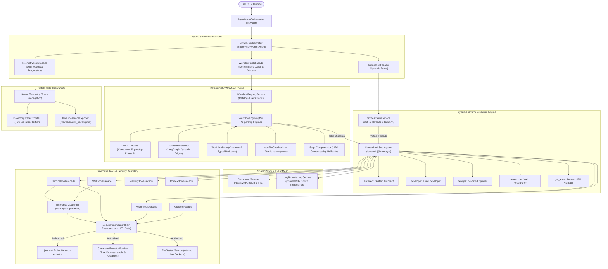

# Computer Use AI Agent: Enterprise Architecture & System Specification

## 1. Executive Architectural Overview

The **Computer Use AI Agent** is a production-grade, local Multi-Agent AI system engineered in **Java 21** using **LangChain4j**, **Ollama (`llama3.1`, `llama3.2-vision`)**, **Java 21 Virtual Threads (Project Loom)**, and **OpenTelemetry (OTel)** distributed tracing. 

The architecture unifies dynamic, open-ended sub-agent delegation with deterministic, Bulk Synchronous Parallel (BSP) DAG workflow execution, atomic checkpointing, cooperative Human-in-the-Loop (HITL) suspension, and automated Saga compensating rollbacks.



---

## 2. Multi-Agent Swarm Orchestration Engine

### 2.1 Dynamic Worker Agent Factory (`SubAgentFactory`)
- **Universal Contract:** All agents implement the unified [`WorkerAgent`](file:///e:/computer-agent/src/main/java/com/agent/WorkerAgent.java) interface:
  ```java
  public interface WorkerAgent {
      String execute(String task);
      String execute(Object memoryId, String task);
  }
  ```
- **Configuration-Driven Manifest ([`src/main/resources/agents.json`](file:///e:/computer-agent/src/main/resources/agents.json)):** Declarative agent definitions define scoped responsibilities and tool boundaries:
  - `architect`: System planning, AST structural exploration, package mapping (`terminal`, `memory`, `context`).
  - `developer`: Surgical file creation, regex patching, refactoring, and code generation (`terminal`, `memory`, `context`).
  - `devops`: Build lifecycle, test verification, git auditing, and releases (`terminal`, `git`, `context`).
  - `researcher`: Web research, documentation lookup, and DOM extraction (`web`, `memory`, `context`).
  - `gui_tester`: Desktop vision inspection, SoM grid localization, mouse/keyboard actuation (`vision`, `context`).
- **Memory Isolation & Bounding:** Each sub-agent maintains isolated `@MemoryId` chat memory windows (`DelegatingChatMemory`). Chat memory keys are scoped per agent profile (`agentId#memoryId`) to eliminate cross-agent context contamination. Memory windows are capped at 1,000 active entries with automated LRU eviction and prefix-based eviction upon workflow completion (`evictMemoryByPrefix`).

### 2.2 Concurrency & Thread-Safe State Sharing
- **Virtual Threads Execution (`OrchestrationService`):** Independent tasks dispatched via `delegateParallel` execute on lightweight Java 21 Virtual Threads (`Executors.newVirtualThreadPerTaskExecutor()`), synthesizing outputs concurrently with zero thread contention.
- **Reactive Blackboard Mesh (`BlackboardService`):** Thread-safe state container supporting cross-agent communication (`writeToBlackboard`, `readFromBlackboard`), time-to-live expiration (TTL), reactive event listening via `BlackboardListener`, and non-polling synchronization via `awaitKey(namespace, key, timeout)`.

---

## 3. Deterministic Declarative Workflow Engine (DAGs)

The `WorkflowEngine` implements a Bulk Synchronous Parallel (BSP) graph execution model inspired by Google Pregel and LangGraph.

### 3.1 BSP Superstep Lifecycle
Each workflow superstep executes across three deterministic phases:
1. **Phase A: Concurrent Execution:** Active DAG nodes are dispatched concurrently onto Java 21 Virtual Threads. Each node receives an immutable, filtered state snapshot according to its declared `readChannels`.
2. **Phase B: Synchronization Barrier & State Reduction:** The engine blocks at a virtual thread barrier, gathers partial node outputs, validates them against declared `writeChannels`, and merges them atomically into `WorkflowState` using typed channel `Reducer` instances (e.g. `AppendListReducer`, `OverwriteReducer`).
3. **Phase C: Planning & Edge Evaluation:** Outbound edges from executed nodes are evaluated against the newly reduced state using `ConditionEvaluator`. Dynamic conditional edges branch execution paths deterministically.

### 3.2 Human-In-The-Loop (HITL) Cooperative Suspension
- **Interrupt Breakpoints:** Nodes declare `interruptBefore` or `interruptAfter` breakpoints.
- **State Suspension:** When an interrupt is triggered, `WorkflowEngine` halts cleanly without blocking OS threads, records a `SUSPENDED` checkpoint, and preserves sub-agent chat memory.
- **Resumption (`resumeWorkflow`):** Callers supply the `threadId` and optional state updates. The engine restores the checkpoint, applies human updates, re-evaluates outbound edges, and resumes forward execution.

### 3.3 Saga Pattern Distributed Compensating Rollback
- **Forward & Rollback Pairs:** Workflow nodes declare optional compensating actions (`compensationAgentId` and `compensationInstruction`).
- **LIFO Compensation Stack:** As forward nodes complete successfully, their compensation records are pushed onto an execution stack.
- **Automated Rollback:** If a downstream node fails (or an unhandled exception occurs), the engine halts forward progress, enters rollback mode, and executes compensating actions in reverse chronological order (LIFO), saving a `ROLLED_BACK` checkpoint and evicting thread memory.

### 3.4 Scoped State Contracts
- **`readChannels`:** Filters the state snapshot presented in the node prompt, preventing context window saturation.
- **`writeChannels`:** Restricts which channels a node's output can mutate, enforcing strict least-privilege boundaries.

---

## 4. OpenTelemetry Distributed Tracing & Observability

Enterprise-grade distributed tracing is integrated throughout the engine via `SwarmTelemetry`:
- **W3C Distributed Trace Context:** Spans propagate trace and parent span identifiers across Virtual Thread supersteps and sub-agent invocations.
- **Automated Tool Instrumentation:** All `@Tool` methods across all 6 core facades (`TerminalToolsFacade`, `GitToolsFacade`, `WebToolsFacade`, `MemoryToolsFacade`, `ContextToolsFacade`, `VisionToolsFacade`) execute inside automatic `tool.execute` child spans recording tool name, arguments JSON, execution duration, and error status.
- **Condition Evaluator Telemetry:** Evaluated DAG edges emit `condition.evaluated` span events flagging any referenced state keys absent from `WorkflowState`.
- **Dual Exporters:**
  - `InMemoryTraceExporter`: Circular buffer (1,000 spans) powering runtime diagnostics and live dashboard queries.
  - `JsonLinesTraceExporter`: Append-only persistence writing JSON lines to `.traces/swarm_traces.jsonl`.
- **Supervisor Facade (`TelemetryToolsFacade`):** Exposes `getTelemetrySummary()` (spans, prompt/completion tokens, average latencies) and `getRecentTraces(limit)`.

---

## 5. Enterprise Tools, Sandboxing & Security

### 5.1 Process Resilience & Sandboxing (`CommandExecutorService`)
- **Recursive Process Tree Destruction:** Leverages Java 9+ `ProcessHandle.descendants()` to recursively terminate child and grandchild processes upon timeout or cancellation, preventing orphan process hangs on Windows (`cmd.exe`) and Linux (`sh`).
- **Asynchronous Stream Gobblers:** Drains stdout and stderr concurrently on dedicated Virtual Threads using UTF-8 `ByteArrayOutputStream` buffers capped at 512KB to protect JVM heap memory.
- **Working Directory Sandboxing:** Enforces directory restrictions to prevent path traversal outside designated project roots.

### 5.2 Atomic Filesystem Operations (`FileSystemService`)
- **Automatic `.bak` Snapshots:** Creates `.bak` recovery copies before mutating or replacing file content.
- **Payload & Binary Protections:** Enforces a 5MB payload limit and inspects the initial 1024 bytes for null bytes (`0x00`) to prevent accidental binary file corruption.

### 5.3 Fair Human-In-The-Loop Gate (`SecurityInterceptor`)
- **Fair Concurrency Serialization:** Utilizes a static fair `ReentrantLock(true)` to ensure that concurrent Virtual Threads prompting for interactive console approval (`System.in`/`System.out`) are queued and served in exact FIFO arrival order without interleaving or deadlock.

### 5.4 Desktop Vision & Actuation (`VisionToolsFacade`)
- **10x10 Set-of-Marks (SoM) Grid Overlay:** Overlays a 100-cell grid with contrasting borders and numeric markers (`0` to `99`) over screen captures, providing semantic coordinate grounding for vision models.
- **Precision Desktop Actuation:** Supports normalized relative offsets (`clickGridOffset`), double clicks, right clicks, wheel scrolling, clipboard text pasting with retry backoff, and safe sequential hotkey pressing with guaranteed reverse-order release.

---

## 6. Enterprise Guardrails & Self-Defense (Phase 10.8.2)

To eliminate infinite tool loops, blind file overwrite hazards, SSRF vulnerabilities, prompt injection attacks, and credential leaks, the framework includes a comprehensive self-defense subsystem under `com.agent.guardrails`:

### 6.1 Tool Loop Circuit Breakers (`ToolLoopGuard`)
- **Identical Tool Repeat Detection:** Breaks consecutive identical tool calls (`A -> A -> A`) with identical parameters (default threshold: 3).
- **Two-Step Ping-Pong Oscillation:** Detects back-and-forth ping-pong oscillations (`A -> B -> A -> B -> A -> B`) across window sizes up to 10.
- **Runaway Turn Ceiling:** Hard limit on total tool executions within a single agent turn (default: 25).
- **Automatic Span Interception:** Injects `guardrail.blocked = true`, `guardrail.reason`, and sets `SpanStatus.ERROR` before tripping, aborting wasted model generation.

### 6.2 Read-Before-Write File Context Gate & Diffs (`FileContextGate`, `UnifiedDiffGenerator`)
- **Read-Before-Write Enforcement:** Prevents agents from blindly overwriting existing files without inspecting them first via `readFile` or `readFileLines`.
- **Stale-Write Conflict Detection:** Computes SHA-256 fingerprints upon reading; if an external process modifies the file before the write executes, the gate rejects the stale mutation.
- **Unified Hunk Diffs:** Automatically outputs standard unified diffs (`--- a/...`, `+++ b/...`, `@@ ... @@`) upon successful mutations.

### 6.3 SSRF Network Guard & Untrusted Content Sanitization (`WebUrlPolicyGuard`, `UntrustedContentSanitizer`)
- **Protocol & Network Boundary Isolation:** Restricts browser navigation strictly to `http` and `https`, blocking non-HTTP schemes (`file://`, `javascript:`, `data:`, `ftp://`). Blocks local hostnames (`localhost`, `*.internal`, `instance-data`), loopback (`127.0.0.0/8`, `::1`), link-local / cloud metadata endpoints (`169.254.169.254`), and RFC-1918 private LANs (`10.0.0.0/8`, `172.16.0.0/12`, `192.168.0.0/16`).
- **Prompt Injection & Spoofed Header Defanging:** Scrapes untrusted pages and neutralizes injection overrides (`ignore all previous instructions`, `you are now in developer mode`), strips raw control tokens (`<|im_start|>`, `<|eot_id|>`), and neutralizes spoofed internal headers.

### 6.4 Secret & Credential Redaction Engine (`SecretRedactor`)
- **Comprehensive Pattern Scrubbing:** High-performance, zero-dependency pre-compiled regex engine scrubbing AI API keys (OpenAI, Anthropic, Google, Slack), GitHub PATs, AWS access keys, bearer tokens, PEM private keys, database connection URI passwords, and JSON/YAML/.env secret assignments.
- **Automatic Telemetry & Checkpoint Scrubbing:** Deeply scrubs spans in `SwarmSpan` (`.traces/swarm_traces.jsonl`), trace exporters, and workflow state data before persisting to disk (`.checkpoints/`).

---

---

## 7. Autonomous Computer-Use Agent (CUA) & Advanced Vision (Phase 10.9)

To enable human-level desktop automation without fragile pixel guesswork, the vision subsystem under `com.agent.tools.vision` provides an end-to-end Computer-Use Agent stack:

### 7.1 Precision Coordinate Engine & Normalized Space (`CoordinateConverter`)
- **Normalized [0..1000] Coordinate System:** Maps continuous normalized [0..1000] coordinates to physical device pixels across arbitrary display resolutions, multi-monitor setups, and high-DPI scalings.
- **Visual Cursor Rendering & Set-of-Marks (SoM):** Renders visible cursor crosshairs (`+`) at the exact mouse location on captured frames (overcoming native `Robot` OS cursor omission) alongside dual-mode Set-of-Marks grids (10x10 numeric grid and dynamic window bounding tags).
- **Region Zoom & High-DPI Inspection:** Provides focused sub-region cropping and scaling (`inspectScreenRegion`) for reading dense menus, tiny text, and complex multi-window layouts.
- **Actuation Suite:** Full mouse and keyboard actuation including drag-and-drop (`dragAndDrop`), clipboard integration (`getClipboardText`), and pre-clearing text fields (`clearFirst`).

### 7.2 Native Desktop Window & Application Management (`DesktopWindowService`, `WindowInfo`)
- **OS Window Enumeration & Foreground Tracking:** Discovers all visible desktop top-level windows across Windows (`tasklist` / PowerShell) and Linux (`wmctrl` / `xdotool`), extracting PIDs, process names, titles, and exact physical and normalized bounds.
- **Window Grounding Set-of-Marks Overlay:** Annotates window bounds directly on screenshots with color-coded tags (`[W1]`, `[W2]`, ...) and highlights the active foreground window.
- **Application Control & Launching:** Brings target windows to foreground (`focusWindow`), minimizes/maximizes/restores/closes windows (`controlWindow`), targets relative points within windows (`clickWindowPoint`), and launches new desktop processes (`launchApp`).

### 7.3 Visual State Diffing, Post-Action Self-Verification & Compound Macros (`ScreenDiffService`, `ScreenDiffResult`)
- **Sub-Pixel Screen Diffing:** Compares pre-action and post-action desktop screenshots pixel-by-pixel, calculating changed pixel percentage (`changedPixelPercent`), pixel count, and computing the normalized bounding box `[minNormX, minNormY, maxNormX, maxNormY]` of all visual changes.
- **Post-Action Self-Verification:** Automatically wraps every actuation tool with visual verification, alerting the agent when an action produced a visual change (`[VISUAL VERIFICATION: x.xx% screen change]`) or warns when the UI did not react (`[VISUAL WARNING: 0.00% screen change detected]`).
- **Dynamic Screen Settle Waiter:** Implements an adaptive polling loop (`waitForScreenSettle`) that verifies desktop visual stability before submitting subsequent inputs.
- **Compound GUI Macros:** Atomically executes multi-step interaction plans (`executeGuiMacro`) with a single consolidated HITL permission check and consolidated visual diffing.

### 7.4 Desktop CUA Skills Catalog, Parameterized Macro Templates & Visual HUD (`DesktopSkillRegistry`, `CuaHudOverlay`)
- **Parameterized Macro Templates (`DesktopSkill`):** Immutable, Jackson-serializable procedural macro manifests supporting dynamic parameter substitution (e.g. `{{url}}`, `{{content}}`, `{{query}}`) via regex replacement and strict required parameter validation.
- **Built-in & Custom Skills Catalog:** Discovers default skills from classpath (`/skills/*.json`: `browser_navigate_url`, `notepad_write_save`, `system_quick_find`) and local disk (`skills/`), supporting runtime registration and disk persistence (`saveDesktopSkill`).
- **Non-Blocking Visual HUD Overlay (`CuaHudOverlay`):** An undecorated, always-on-top, transparent status banner (`JWindow`) that renders live CUA actions, target coordinates, and visual verification statuses in real-time on physical displays, while remaining 100% headless-safe in CI environments.

---

## 8. Distribution, Testing & Operational Health

- **Executable Fat JAR:** Shaded via `maven-shade-plugin` with `ServicesResourceTransformer` and `ManifestResourceTransformer` into `target/computer-agent-1.0.0-SNAPSHOT.jar`.
- **Built-In Workflow & Skill Catalogs:** Packaged into classpath resources under `workflows/` and `skills/`.
- **Automated Test Coverage:** Comprehensive test suite of **299 automated tests passing with 0 failures and 0 errors**, validating unit, security isolation, concurrency, BSP supersteps, Saga rollbacks, reactive pub/sub, distributed telemetry, Phase 10.8.2 Enterprise Guardrails, and Phase 10.9 Autonomous Computer-Use Agent upgrades.